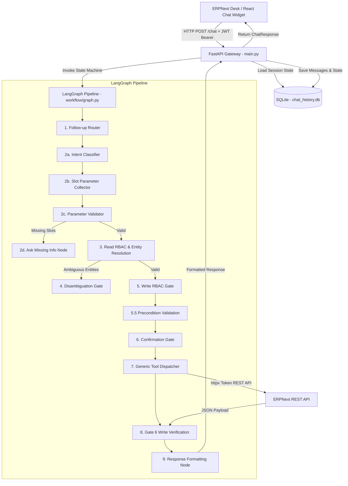

# AI Assistant for ERPNext

An AI chatbot agent for **ERPNext / Frappe Desk**, built with **FastAPI**, **LangGraph**, **React**, and LLMs served through **Groq** (or **xAI**).

The assistant translates natural-language requests into verified ERPNext REST API operations. It enforces role-based access control (RBAC), validates required fields before acting, asks for confirmation before writes, and verifies the result after a document is created.

> [!IMPORTANT]
> **Current Version**: This README describes the **`integration-fixed`** branch, which is the current working version of the project. The `main` branch may not reflect the latest features and fixes.

---

## Key Features

* **19 declarative skills**: Natural-language workflows for Customers, Sales Orders, Purchase Orders, Items, Stock, and Business Analytics. Each skill is defined as a spec in `skills/`.
* **Multi-step safety pipeline**: A LangGraph state machine (19 compiled nodes covering 10 main stages) handles intent classification, slot collection, parameter validation, entity resolution, RBAC checks, precondition checks, and a confirmation gate.
* **Write verification (Gate 6)**: After a create operation, the returned document is checked immediately (including its `name`) to prevent duplicate retries.
* **Session state**: Conversation messages and slot state, including the last created document (`last_created_doc`), are persisted in SQLite (`chat_history.db`). This lets the agent resolve some follow-ups such as "that customer". See [Known Limitations](#known-limitations) for what does not work yet.
* **Embedded Frappe Desk UI**: A React + TypeScript chat widget bundled as a Desk asset (`assistant.bundle.js`) and shown as a drawer inside ERPNext.
* **Security and audit logging**: JWT authentication matched to ERPNext Desk sessions, role-based permission checks, and a SQLite audit log (`audit_log.db`).
* **DocType whitelist**: Generic CRUD tools only operate on a fixed set of 12 DocTypes (configurable through an environment variable).

---

## Architecture

The diagram below is a simplified view of the pipeline. The compiled graph in `agent/workflow/graph.py` contains additional helper nodes.



---

## Tech Stack

* **Backend**: Python 3.13+, FastAPI, LangGraph, LangChain Core, Pydantic v2
* **LLM providers**: Groq (default model `openai/gpt-oss-120b`, with `openai/gpt-oss-20b` and `qwen/qwen3.8-27b` as fallbacks) or xAI (`grok-2-latest`). The model can be overridden with `GROQ_MODEL`. See `agent/llm.py`.
* **ERPNext integration**: HTTP REST API via `httpx`, token authentication (`token API_KEY:API_SECRET`), and JWT session bearer tokens
* **Frontend widget**: React, TypeScript, Vite, and plain (vanilla) CSS
* **Frappe Desk integration**: Custom Frappe app (`ai_assistant`) with Desk hooks (`hooks.py`) and a bundled asset (`assistant.bundle.js`)
* **Persistence and auditing**: SQLite (`chat_history.db` for sessions, `audit_log.db` for audit trails)
* **Containerization**: Docker and Docker Compose (`docker-compose-integration.yml`)

---

## Project Structure

```text
erpnext-ai-assistant/
├── agent/                         # FastAPI agent service
│   ├── main.py                    # Entrypoint, REST endpoints, JWT auth (port 8000)
│   ├── chat_store.py              # SQLite session persistence
│   ├── audit_logger.py            # Security audit logging
│   ├── llm.py                     # Groq / xAI LLM integration
│   ├── requirements.txt           # Python dependencies
│   ├── Dockerfile                 # Agent container build
│   ├── tools/
│   │   ├── erpnext_client.py      # Low-level httpx REST client for ERPNext
│   │   └── generic_tools.py       # Generic CRUD tools and DocType whitelist
│   └── workflow/                  # LangGraph state machine
│       ├── graph.py               # Compiled pipeline and safety gates
│       ├── state.py               # AgentState schema
│       └── followup_router.py     # Deterministic router for read follow-ups
├── skills/                        # 19 declarative skill specs
├── frontend/                      # React + TypeScript + Vite chat widget
│   ├── src/                       # Chat UI components, hooks, styles
│   └── vite.config.ts             # Build config targeting Frappe Desk
├── ai_assistant/                  # Frappe app package
│   ├── hooks.py                   # Desk asset injection
│   └── public/desk/               # Built asset (assistant.bundle.js)
├── docker-compose-integration.yml # Docker Compose stack
├── pyproject.toml                 # Python project configuration
└── license.txt                    # MIT license
```

---

## Installation

### Prerequisites

1. **Python**: 3.13 or higher
2. **Node.js**: 18+ and `npm`
3. **ERPNext instance**: A running ERPNext / Frappe site
4. **Docker** (optional): Only needed for the Docker Compose setup

### 1. Install the Frappe app

Use the `integration-fixed` branch:

```bash
cd $PATH_TO_YOUR_BENCH
bench get-app https://github.com/Picture-Sque/erpnext-ai-assistant --branch integration-fixed
bench install-app ai_assistant
```

### 2. Configure environment variables

Create `agent/.env` (or set the variables in `docker-compose-integration.yml`):

```ini
# LLM provider
GROQ_API_KEY=your_groq_api_key

# ERPNext connection and token credentials
ERPNEXT_BASE_URL=http://localhost:8080
ERPNEXT_API_KEY=your_frappe_api_key
ERPNEXT_API_SECRET=your_frappe_api_secret

# Authentication
JWT_SECRET=your_jwt_shared_secret
ALLOW_DEV_MOCK_AUTH=false

# Optional overrides
# GROQ_MODEL=openai/gpt-oss-120b
# DOCTYPE_WHITELIST=Customer,Item,Sales Order,Bin,Quotation,Sales Invoice,Purchase Order,Supplier,Sales Order Item,Purchase Order Item,Customer Group,Territory
# SQLITE_DB_PATH=chat_history.db
# SQLITE_AUDIT_DB_PATH=audit_log.db
# AGENT_AUTH_TOKEN=...
```

Notes:

* `ALLOW_DEV_MOCK_AUTH` should stay `false` outside local development.
* The code also reads `AGENT_AUTH_TOKEN` and accepts `ALLOWED_DOCTYPES` as an alternative to `DOCTYPE_WHITELIST`. See `agent/main.py` and `agent/tools/generic_tools.py` for how they are used.
* `GEMINI_API_KEY` is not used by the current code.

### 3. Build the Desk widget

```bash
cd apps/ai_assistant/frontend
npm install
npm run build
```

The build writes `ai_assistant/public/desk/assistant.bundle.js`, which Frappe Desk loads.

### 4. Run the agent service

**Option A: Direct**

```bash
cd apps/ai_assistant/agent
pip install -r requirements.txt
uvicorn main:app --host 127.0.0.1 --port 8000
```

**Option B: Docker Compose**

```bash
docker compose -f docker-compose-integration.yml up -d --build
docker compose -f docker-compose-integration.yml ps
```

The agent service listens on port `8000`.

---

## Usage

### Customers
* **Create**: `"Create a customer named Apex Cybernetics"`
* **List**: `"Show all customers"` or `"List customers in Commercial group"`
* **Lookup**: `"Look up customer West View Software Ltd."`

### Sales Orders
* **Create**: `"Create a sales order for Acme Corp with SKU001 qty 5"`
* **Follow-up creation**: *"Create a customer named Nova Tech"*, then *"Create a sales order for that customer with SKU001 qty 2"*
* **Lookup**: `"Show me sales order SAL-ORD-2026-00013"`
* **Customer order history**: `"Show all orders for Acme Corp"`
* **Submit / Cancel / Update**: `"Submit sales order SAL-ORD-2026-00013"`

### Purchase Orders
* **Create**: `"Create a PO for Zuckerman Security for ITEM-DESK-001 qty 50"`
* **Lookup / Update / Submit / Cancel**: `"Show purchase order PUR-ORD-2026-00013"`

### Stock and Inventory
* **Check stock**: `"How much SKU001 do we have?"`
* **Low stock report**: `"What items are running low?"`

### Business Analytics
* **Top customer / item**: `"Who is our top customer by order value?"` or `"What is our best-selling item?"`
* **Sales summary**: `"Total sales for August 2026"`

---

## Known Limitations

1. **One request per message.** When a message contains several independent requests (for example, *"Create a sales order for Acme and delete a previous order"*), only the first is executed. When the agent detects the remaining steps, it appends a note saying they were **not attempted**; they are never run automatically.
2. **No delete via chat.** A `delete_document` tool and its confirmation and verification gates exist in the backend, but there is no delete skill in `skills/`, so deletion requests cannot be routed to it. A request like *"Delete that sales order"* will not delete anything.
3. **Limited reference resolution.** The last created document is persisted in session state, and some follow-ups work: "that customer" is resolved explicitly, and submit/cancel can refer to the last document when the DocType matches. References such as *"that sales order"* are not reliably resolved across arbitrary later requests.
4. **Drawer UI only.** The chat renders as a sliding drawer inside Frappe Desk, not as a full-page view.
5. **No new-chat button or history list.** Conversations are persisted in SQLite, but the UI cannot start a fresh chat or switch between saved sessions.
6. **Whitelisted DocTypes only.** Generic CRUD tools are restricted to 12 DocTypes: `Customer`, `Item`, `Sales Order`, `Bin`, `Quotation`, `Sales Invoice`, `Purchase Order`, `Supplier`, `Sales Order Item`, `Purchase Order Item`, `Customer Group`, `Territory`. The list can be changed through the `DOCTYPE_WHITELIST` environment variable.

---

## Roadmap / Future Scope

* **"New Chat" and chat history**: A "New Chat" button that opens a fresh chat window, with all previous chats saved and browsable in a history list.
* **Full-page chat mode**: Clicking the chatbot icon expands the chatbot to occupy the entire page.
* **Multi-intent execution**: Detect multiple requests in one message and execute them in order (for example, create a sales order, then delete a previous one), with a combined response summarising every action.
* **Stronger conversation memory**: Remember earlier requests and the records created or referenced in them, so follow-ups like *"delete that sales order"* resolve to the right document.
* **Delete skill**: Expose the existing backend delete tool through a skill, with confirmation required before anything is removed.

---

## Contributing

This app uses `pre-commit` for code formatting, linting, and quality checks. [Install pre-commit](https://pre-commit.com/#installation) and enable it for this repository:

```bash
cd apps/ai_assistant
pre-commit install
```

Configured tools (see `.pre-commit-config.yaml`):

* **Python**: `ruff` (linting and import sorting), `ruff-format` (formatting)
* **JS / TS**: `eslint`, `prettier`
* **General checks**: `trailing-whitespace`, `check-merge-conflict`, `check-ast`, `check-json`, `check-toml`, `check-yaml`, `debug-statements`

---

## License

MIT. See [`license.txt`](license.txt) for details.
